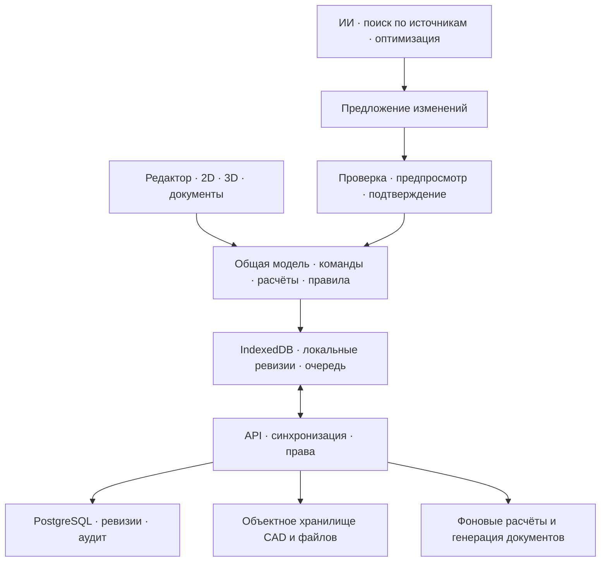

# План развития «Панель 36»

Дата: 16 октября 2026 года. Основа: репозиторий `bublikamun-code/proekt36`, версия 0.3.0, коммит `0bb3d31dbee9e7fec9fc71188a635bea5523ae0b`.

Этот документ — стратегия. Операционный план исполнения — [REWORK_PLAN.md](../../REWORK_PLAN.md), история доски — [BOARD_PLAN.md](../../BOARD_PLAN.md), конкурентные ориентиры — [конкурентное исследование](panel36-competitor-analysis.md) того же дня.

## 1. Цель продукта

Создать инженерную платформу для проектирования и сборки электрощитов: пользователь задаёт нагрузки и ограничения, получает проверяемый вариант щита, редактирует его, выпускает согласованный комплект документов и передаёт проект в сборку. Каждое инженерное решение должно иметь объяснение, исходные данные и версию расчёта.

Первая целевая аудитория — электромонтажники, сборщики щитов и небольшие проектные бюро. Это рабочее предположение для плана; его нужно подтвердить интервью. Первый класс задач — типовые распределительные щиты жилых и небольших коммерческих объектов. Промышленную автоматику, управление оборудованием и сложные расчёты сетей следует оценивать отдельными направлениями.

Главный сценарий: **нагрузки → схема → оборудование → компоновка → проверки → документы → сборка**.

Ценность для пользователя: меньше повторной работы, быстрее выпуск проекта, понятные ошибки и воспроизводимый результат. Технологическое развитие измеряем улучшением этого сценария.

## 2. Исходное состояние

Уже реализованы Vue 3 / TypeScript, Pinia, редактор и отдельная доска, устройства, цепи, соединения с номерами зажимов, локальное сохранение, история изменений, импорт CAD, экспорт архивов с моделями, предварительные проверки, печатная однолинейная схема, PWA и локальный ИИ-прокси. Часть документа `docs/BOARD_PLAN.md` описывает раннее состояние; перед созданием задач учитывать последующие разделы о выполненной работе.

Основные ограничения: нет серверной авторизации, синхронизации и совместной работы; параметры рабочего каталога не подтверждены паспортами; расчёты и документы имеют предварительный статус. Результаты последней проверки от 15 октября: сборка и TypeScript прошли, 245 модульных тестов прошли, npm audit сообщил 0 известных уязвимостей. Полный браузерный набор, Docker и реальные обращения к провайдерам тогда не запускались. Эти результаты не являются новой проверкой релиза 16 октября.

Подтверждены два дефекта: путаница L3 с трёхфазной нагрузкой и неверный счётчик цепей без защиты в ИИ-сводке. По чтению кода выявлена несогласованная настройка порта ИИ-прокси. Офлайн-кэш требует проверки в браузере.

## 3. Продуктовые решения для первого этапа

1. Провести 5–10 интервью с представителями выбранной аудитории; получить примеры щитов и документов с разрешением на использование, обезличить материалы.
2. Выбрать один сегмент и 3 повторяющихся сценария проектирования для пилота.
3. Выбрать первую страну/юрисдикцию, применимые нормы и условия расчёта. Зафиксировать редакции документов и права на использование источников.
4. Назначить специалиста по электротехнике, который проверяет методики, каталог и эталонные проекты.
5. Записать исходное время выполнения каждого сценария и типовые ошибки. Сравнивать будущие версии с этой базой.

Критерий завершения: согласован короткий продуктовый документ — пользователь, задача, ограничения, критерии успеха, 3 эталонных проекта. Разработку исправлений этапа 0 можно вести одновременно с интервью.

## 4. Дорожная карта

Этапы — последовательность результатов. Оценки ниже предварительные и не являются обещанием срока. Первые два этапа уточняются после разбора модели нагрузки; последующие — после пилота. Переход к следующему этапу определяется критериями готовности.

### Этап 0. Надёжная основа

**Результат:** существующим функциям можно доверять в рамках явно обозначенных ограничений.

- Разделить понятия номера фазы, количества фаз нагрузки, напряжения и способа подключения. Учесть однофазные нагрузки L1/L2/L3 и отдельно трёхфазные нагрузки; для расширенных расчётов определить cos φ, коэффициенты спроса и условия применимости.
- Исправить расчёты мощности, тока и распределения нагрузки. При изменении формата проекта добавить миграцию; неоднозначные старые данные помечать для уточнения пользователем.
- Исправить ИИ-сводку: проверять существование и назначение защитного аппарата, согласовать агрегаты с доменной диагностикой.
- Объединить настройку адреса/порта ИИ-прокси и проверить dev, production и nginx. Чётко определить поддерживаемый сценарий доступа с другого устройства.
- Проверить PWA: первое открытие, повторное открытие без сети, переход на ранее не открытый экран, обновление версии, активные вкладки старой версии, ошибка сети и частично заполненный кэш.
- Ввести документированный порядок выпуска, резервного копирования, миграции и восстановления пользовательских данных при откате приложения.

**Готово, когда:** одинаковая однофазная нагрузка даёт одинаковый ток на L1/L2/L3; трёхфазная нагрузка корректно распределяется; старые проекты мигрируют без молчаливого изменения смысла; ИИ-сводка совпадает с моделью; поддерживаемые конфигурации прокси проверены; выполнен `npm run verify`, а производственный PWA-сценарий проверен отдельно с реально включённым service worker.

### Этап 1. Проверяемое инженерное ядро и каталог

**Результат:** единая модель щита с воспроизводимыми расчётами.

- Выделить независимые пакеты модели проекта, расчётов, правил и каталога. Сохранить текущий Vue-интерфейс и переносить код небольшими частями.
- Развить имеющиеся соединения и зажимы в явный электрический граф: устройства, зажимы, связи, шины, полюса и принадлежность фазам. Геометрию и внешний вид хранить отдельно от электрической связности.
- Однолинейную схему, доску, спецификацию и монтажные таблицы строить из одной ревизии проекта.
- Создать версионируемые наборы правил с источником, редакцией, областью применения, входными данными, уровнем серьёзности и объяснением результата.
- Добавлять падение напряжения, выбор проводников и защит только вместе с необходимыми данными: длина, материал, способ прокладки, температура и прочие условия конкретной методики.
- Отдельно оценить расчёты КЗ, отключающей способности и селективности. Для них потребуются параметры питающей сети и проверенные таблицы производителей; отсутствие данных должно давать статус «недостаточно данных».
- Создать процесс ведения каталога: источник, артикул, размеры, параметры, схема зажимов, совместимость аксессуаров, дата и автор проверки. Статус проверки 3D-геометрии учитывать отдельно.
- Сохранять снимок каталога и версию правил с выпущенной ревизией проекта; обновление каталога предлагать как видимое изменение.
- Подготовить минимум 10 эталонных проектов со специалистом и начать с 30–50 действительно проверенных позиций пилотного каталога.

**Готово, когда:** повторный расчёт на тех же данных и версиях воспроизводим; все представления согласованы; результаты эталонов подтверждены специалистом; каталог показывает происхождение характеристик; неизвестные параметры не заполняются предположениями без явного указания.

### Этап 2. Профессиональный редактор и выпуск документов

**Результат:** в продукте можно выполнить выбранные пилотные задачи целиком.

- Пакетный выбор, копирование групп, горячие клавиши, поиск команд, привязки и выравнивание, шаблоны типовых узлов, удобная навигация по большим щитам.
- Клик по диагностике выделяет конкретный аппарат, зажим или связь; исправление показывает последствия.
- Показать изменения проекта: какие аппараты, параметры, провода и документы изменились между двумя ревизиями.
- Развить существующий печатный отчёт: титульная информация, схема, спецификация, маркировка, таблица соединений и перечень замечаний. Добавить управляемый PDF и CSV/XLSX для пилотного процесса.
- Ввести контрольный список готовности к сборке. Выпускать документ с ревизией, датой и статусом проверки; черновики и неполные расчёты обозначать явно.
- Выполнять тяжёлые расчёты и обработку моделей в Web Workers, измерять задержки. WebAssembly рассматривать после профилирования конкретного узкого места.
- Проверить клавиатурное управление, масштабирование, читаемость, тёмную тему и печать на реальных рабочих местах.

**Готово, когда:** 5 пилотных пользователей выполняют выбранные сценарии; все выданные документы относятся к одной ревизии; замечания доступны с доски; достигнут согласованный порог скорости на опубликованном тестовом устройстве.

### Этап 3. Аккаунты, локальная работа и командные проекты

**Результат:** проект доступен с нескольких устройств, данные восстановимы, доступ разграничен.

- Добавить серверную идентификацию и организации. Предусмотреть стандартные механизмы входа и MFA; роли: владелец, проектировщик, проверяющий, просмотр.
- Перевести основное локальное хранилище на IndexedDB с транзакциями; существующие localStorage-данные мигрировать с контрольным сравнением. Небольшие настройки интерфейса можно оставить отдельно.
- Добавить очередь изменений, явный статус синхронизации, повтор запросов без дублирования операций и проверку базовой серверной ревизии.
- Сначала реализовать сохранение ревизий и видимое разрешение конфликтов. Первая командная версия может использовать блокировку редактирования или ветви изменений.
- Для одновременного редактирования провести отдельный эксперимент с CRDT/OT. Слияние не должно создавать недопустимые соединения или скрывать конфликт инженерных решений; результат проходит доменную валидацию и атомарную фиксацию.
- Реализовать изоляцию организаций на сервере, временные ссылки на файлы, квоты, аудит доступа, резервные копии и проверенное восстановление.
- Добавить согласование ревизий и публикацию неизменяемой версии для сборки.

**Готово, когда:** проект переживает работу без сети и последующую синхронизацию; конфликт двух клиентов виден и разрешим; тесты подтверждают изоляцию организаций; восстановление из резервной копии проверено; согласованная ревизия не меняется задним числом.

### Этап 4. Интеллектуальный помощник и оптимизация

**Результат:** помощник предлагает проверяемые варианты и сокращает время проектирования.

- Развить существующего помощника: вопросы о проекте, объяснение правил, сравнение ревизий и предложение изменений с предпросмотром.
- Добавить поиск по разрешённым документам производителей и проверенной базе знаний с точными ссылками на источник и его редакцию. Разграничить общие источники и закрытые материалы организаций.
- Структурированные предложения преобразовывать в команды приложения; перед применением запускать схему, электрические проверки и проверку прав. Пользователь подтверждает изменение и видит возможность отмены.
- Разрабатывать автокомпоновку как задачу с явными ограничениями: габариты, резерв, тепловые и монтажные условия, фиксированные устройства. Возвращать несколько вариантов и причины невозможности.
- Автобалансировку фаз, стоимость и длину проводов оптимизировать детерминированным алгоритмом/решателем с жёсткими ограничениями. LLM может формулировать запрос и объяснять результат.
- Не разрешать улучшение показателей путём скрытого повышения вводного тока или ослабления ограничений. Изменение таких параметров — отдельное инженерное решение с обоснованием.
- Создать набор минимум из 100 проверенных сценариев оценки помощника: неполные данные, ложные предпосылки, вредоносные инструкции в документах, неверные ссылки, несовместимые действия, устаревшая ревизия проекта.
- Добавить бюджеты запросов, лимиты, выбор модели, журнал применённых действий и явное описание того, какие пользовательские тексты и данные передаются провайдеру. Условия хранения данных выбрать до пилота.

**Готово, когда:** все действия проходят контролируемые команды; на фиксированном наборе оценок нет запрещённых применений, неподтверждённые утверждения маркируются, ошибки и стоимость измеряются. Этот результат не означает гарантии для любых будущих запросов.

### Этап 5. 3D-проверка и поддержка сборки

**Результат:** геометрия помогает обнаруживать проблемы до монтажа.

- Развить существующее Three.js-превью в представление всей сборки, связанное с электрической моделью.
- Для проверенных моделей добавить габариты, установочные зоны, глубину, точки подключения и зоны обслуживания; проверять коллизии.
- Оценивать трассы и длину проводов с учётом каналов, радиусов изгиба и монтажного запаса. Показывать допущения и степень точности.
- Проверить взаимодействие 2D и 3D: выбор одного объекта, общая ревизия, единые размеры и номера зажимов.
- Добавить режим сборки по выпущенной ревизии: маркировка, пошаговый перечень соединений, отметки проверки, фото замечаний и история изменений после сборки.
- Тепловые оценки включать только после выбора методики, получения необходимых данных и проверки на эталонах. Точность инженерной симуляции заявлять в пределах подтверждённой модели.

**Готово, когда:** габариты пилотных изделий проверены; коллизии и длины сверены с физическими примерами; сборщик может пройти проверяемый сценарий по неизменяемой ревизии. Подключение датчиков и эксплуатационный цифровой двойник — отдельная следующая программа с реальным источником телеметрии.

### Этап 6. Коммерческая платформа и интеграции

**Результат:** продукт можно устойчиво продавать и сопровождать.

- Коммерческое предложение на основе пилота: индивидуальная работа, команда и согласование, сборочное производство. Состав тарифов проверить на готовности платить.
- Интеграции поставщиков: стоимость, регион, валюта, дата актуальности, остатки и происхождение данных. Сравнивать техническую совместимость до цены.
- Заявки на закупку и связь с ERP/CRM через версионируемый API и подписанные webhook; права и повторы доставки проверяются.
- Биллинг, учёт лимитов, обработка ошибок оплаты и понятный экспорт данных при прекращении подписки.
- Сбор эксплуатационных метрик, поддержка, управление инцидентами, резервирование и цели доступности. Инженерные данные и содержимое проектов не включать в телеметрию по умолчанию.

**Готово, когда:** есть повторное использование в пилоте, подтверждённая ценность, первые оплаты, известная стоимость обслуживания организации и работающий процесс поддержки.

## 5. Рекомендуемая техническая архитектура

Текущий Vue 3 / TypeScript сохранить. Инженерное ядро использовать повторно в браузере, серверной проверке и автоматических тестах.

| Область | Предлагаемая основа | Решение о внедрении |
|---|---|---|
| Интерфейс | Vue 3, TypeScript, Pinia; 2D и Three.js | Развивать текущую реализацию |
| Инженерная модель | Пакеты TypeScript: graph, calculations, rules, catalog, commands | Этапы 0–1 |
| Локальные проекты | IndexedDB, транзакции, очередь синхронизации | Прототип на этапе 1, миграция на этапе 3 |
| API | Node.js + TypeScript, модульный монолит; Fastify как кандидат | Этап 3, короткое архитектурное решение |
| Данные сервера | PostgreSQL для организаций, прав, ревизий и метаданных; объектное хранилище для CAD и файлов | Этап 3 |
| Контракты | Версионируемые API и схемы данных, контроль совместимости | До облачной синхронизации |
| Фоновые задачи | Очередь для документов, импорта, ИИ и оптимизации | При появлении длительных операций; отдельный Redis вводить по измеренной потребности |
| Совместная работа | WebSocket, ревизии; CRDT/OT после эксперимента | Этап 3 |
| ИИ | Адаптеры провайдеров, поиск по источникам, команды, оценочные сценарии | Этап 4; локальный режим сохранить при наличии спроса |
| Производительность | Web Workers, профилирование; WASM/решатель по результатам | Этапы 2 и 4 |
| Эксплуатация | Контейнеры, CI/CD, staging, наблюдаемость, резервные копии | Базовые элементы с этапа 0, серверные — с этапа 3 |



Сервер повторно проверяет команды, права и доменные ограничения. Код, работающий в браузере, не является границей доверия. Сохраняются ревизии с версиями правил и каталога; конфликты синхронизации не затирают данные молча.

Начальный способ размещения — контейнеры и управляемые хранилища с тестовым окружением. Выделение микросервисов, Kubernetes, векторной БД или отдельного решателя требует конкретной нагрузки, ограничения или проверенного выигрыша.

## 6. План первых 90 дней

Рабочий ориентир для команды: два разработчика, инженер по электротехнике с регулярным участием, дизайнер/исследователь и QA с частичной загрузкой. При одном разработчике сохраняется порядок, уменьшается объём параллельной работы; сроки нужно переоценить после первого спринта. Облако, полноценная совместная работа и цифровой двойник в первые 90 дней не входят в обязательство.

| Период | Основной результат | Контрольная точка |
|---|---|---|
| Дни 1–14 | Исправления этапа 0; интервью; исходные замеры | Нет известных дефектов L3 и ИИ-сводки; согласованы пилотные задачи |
| Дни 15–30 | Модель нагрузки, миграции, основа графа и эталонные тесты | Независимая проверка инженерной модели и сохранности старых проектов |
| Дни 31–60 | Каталог пилота, объяснимые проверки, согласованность схемы/доски/спецификации | Сквозное прохождение эталонных проектов |
| Дни 61–90 | Документы, удобство редактора, измерение производительности, пилот | Решение о следующей инвестиции по результатам пользователей |

После пилота выбрать следующий приоритет: облачная работа, интеллектуальная оптимизация или подготовка к сборке. Порядок определяется самым дорогим препятствием пользователя и готовностью исходных данных.

## 7. Готовый стартовый бэклог

Приоритет P0 — текущая корректность и данные; P1 — ядро и пилот; P2 — развитие после основания. Оценку задач выставлять после технического разбора. Одна карточка может потребовать декомпозиции.

| ID | Приоритет | Задача | Проверяемый результат | Зависимости |
|---|---|---|---|---|
| ENG-01 | P0 | Разделить L1/L2/L3 и количество фаз нагрузки | Согласована схема; зафиксированы миграция и неоднозначные старые данные | Нет |
| ENG-02 | P0 | Исправить ток/мощность/баланс фаз | 4600 Вт однофазной нагрузки = 20 А при 230 В на любой фазе; отдельные примеры для трёхфазной нагрузки | ENG-01 |
| AI-01 | P0 | Исправить счётчик цепей без защиты | Пустая, потерянная и неверная ссылка не считается защитой; счётчик согласован с диагностикой | Нет |
| OPS-01 | P0 | Согласовать конфигурацию прокси | Документированный способ смены порта работает в dev и поддерживаемой production-конфигурации | Нет |
| OFF-01 | P0 | Проверить и исправить офлайн-обновление | Проверены первое открытие, ленивые экраны, обновление, старые вкладки и неполный кэш | Нет |
| QA-01 | P0 | Выполнить и зафиксировать релизную проверку | `npm run verify`, отдельные PWA-проверки и поддерживаемый контейнерный сценарий успешны | ENG-02, AI-01, OPS-01, OFF-01 |
| PROD-01 | P1 | Выбрать аудиторию и задачи пилота | 5–10 интервью; 3 сценария; исходное время и примеры документов | Нет |
| DATA-01 | P1 | Определить паспорт позиции каталога | Источник, версия, электрические характеристики, зажимы, размеры и отдельный статус геометрии | PROD-01 |
| ENG-03 | P1 | Описать электрический граф и границы ядра | Однозначная модель зажимов, связей, полюсов и фаз; план совместимости | ENG-01 |
| QA-02 | P1 | Собрать инженерные эталоны | Минимум 10 проектов с проверенными ожиданиями и ответственным специалистом | PROD-01, ENG-03 |
| DATA-02 | P1 | Подготовить проверенный каталог пилота | 30–50 позиций с документированными характеристиками и датой проверки | DATA-01 |
| ENG-04 | P1 | Унифицировать представления проекта | Схема, доска и спецификация используют одну ревизию; расхождения ловятся тестами | ENG-03, QA-02 |
| DOC-01 | P1 | Выпустить комплект пилотных документов | Ревизия, статус, схема, спецификация и таблица соединений согласованы | ENG-04, DATA-02 |
| PERF-01 | P1 | Измерить работу на проекте текущего предельного размера | Опубликованы сценарий, устройство, задержки; выбраны конкретные оптимизации | ENG-04 |
| PILOT-01 | P1 | Провести наблюдаемый пилот | 5 пользователей; время, ошибки и повторное использование измерены | DOC-01, QA-01, PERF-01 |
| CLOUD-01 | P2 | Спроектировать локальную и облачную ревизии | Проверены миграция, идемпотентность и конфликт двух клиентов | PILOT-01 |
| AI-02 | P2 | Предложения ИИ с проверкой и предпросмотром | Нет применения вне разрешённых команд; есть версия проекта и журнал результата | ENG-04, QA-02 |
| GEO-01 | P2 | Прототип проверки габаритов и коллизий | Проверенные размеры пилотных моделей и сверка с физическим примером | DATA-02, ENG-04 |

## 8. Метрики и критерии качества

Числа ниже — предлагаемые цели для согласования, а не текущие показатели.

- **Главная продуктовая метрика:** доля пилотных проектов, прошедших путь от создания до комплекта, принятого сборщиком, с учётом повторных исправлений.
- **Скорость:** сократить медианное время выбранных задач на 30% относительно исходного замера; сравнивать одинаковую сложность и учитываемые этапы.
- **Корректность:** все согласованные инженерные эталоны проходят; ни одно расхождение с эталоном не остаётся без объяснения и решения специалиста.
- **Данные:** не допускать молчаливой потери изменений в проверяемых сценариях; перед миграцией иметь восстанавливаемую копию. Для облака задать RPO/RTO и проверять их восстановлением.
- **Редактор:** начальная цель p95 отклика типовых действий <100 мс и тяжёлой повторной проверки <1 с на объявленном тестовом устройстве. Уточнить по замерам текущего лимита: до 500 устройств и 2000 соединений.
- **ИИ:** доля корректных предложений, точность источников, доля отказов из-за нехватки данных, стоимость завершённого сценария, число запрещённых применений на фиксированном наборе оценок.
- **Пилот:** измерять возвращение пользователей и использование на реальных повторных проектах в течение 4 недель; численную цель установить после первого набора.

## 9. Как вести работу по этому плану

1. Вести один упорядоченный бэклог. На спринт брать один законченный пользовательский результат с инженерной проверкой и тестированием.
2. Для задачи указывать: проблему, сценарий пользователя, границы, изменения схемы, критерии приёмки, проверку и способ восстановления.
3. Перед добавлением новой проверки фиксировать формулу, единицы, условия применения, источник и независимый пример расчёта. Различать предупреждение, ошибку и недостаточность данных.
4. Использовать релизные ворота: типы, модульные и интеграционные проверки, нужные e2e, миграции/данные, проверка инженером и пилотные сценарии. Полный текущий `npm run verify` остаётся базовым набором до изменения процесса отдельным решением.
5. Документировать архитектурные решения: зачем изменение, альтернативы, последствия, условие пересмотра. Для данных и публичных форматов проверять совместимость отдельно.
6. Раз в две недели показывать работающий сквозной сценарий и сравнивать метрики с исходной точкой.
7. Подтверждать окончание этапа демонстрацией критериев готовности. Новые функции не переводят непроверенный расчёт в статус подтверждённого.

### Шаблон задачи

```text
ID / название:
Пользователь и проблема:
Сценарий воспроизведения или целевой сценарий:
Что входит в задачу:
Зависимости:
Изменение формата / миграция:
Критерии приёмки:
Проверки и независимые ожидаемые результаты:
Способ восстановления / отката:
Владелец реализации / инженерной проверки:
```

## 10. Основные зависимости и риски

- Доступ к инженеру и паспортам производителей определяет скорость развития расчётов и каталога. Для старта важнее проверенная выборка, соответствующая пилоту, и воспроизводимые примеры.
- Облачная синхронизация зависит от стабильной модели команд, ревизий и миграций. Одновременное редактирование добавляет отдельную задачу семантических конфликтов.
- Автоматическая оптимизация зависит от формализованных ограничений; иначе алгоритм может выдать удобную компоновку с неприемлемыми инженерными параметрами.
- 3D-проверки зависят от точных габаритов и допустимых зон; наличие GLB само по себе не подтверждает пригодность для расчёта коллизий.
- Закупки зависят от API/договоров поставщиков и актуальности цен. Биллинг и размещение данных зависят от выбранного рынка.
- Поддержка каждой дополнительной отрасли и юрисдикции требует собственной проверки методик и источников.

**Первое действие:** начать ENG-01/ENG-02 и AI-01, параллельно провести PROD-01. После надёжной основы сфокусироваться на одном профессиональном сценарии до выпуска документов и пилотной сборки. Это даст проверяемую базу для облака, интеллектуальной оптимизации и цифровой модели щита.
